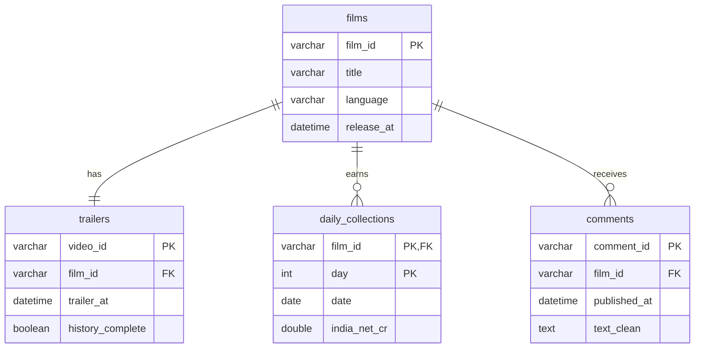

# Trailer Week → Opening Weekend

Question: **Does trailer-week YouTube engagement predict opening-weekend collections across recent Hindi and regional releases?**

The measurable engagement signal is the number of surviving top-level comments published during the first seven elapsed days after one selected official original-language theatrical trailer launched. Current views and likes are not historical measurements and are excluded from predictors. We screen 16 Friday releases from 2025. A full seven-day trailer window must end before the theatrical release date at midnight in India.

The outcome is Friday–Sunday **all-language India nett in INR crores**, computed from three Sacnilk daily rows. We never mix worldwide gross, opening day, missing days or extended weekends into that target. Hindi and regional films share this target, although the original-language trailer may omit dubbed-film audiences.

```text
project/
  src/
    trailer_week_radar.ipynb
    collect.py
    spark_job.py
    load_mysql.py
    schema.sql
    queries.sql
    requirements.txt
    .env.example
    README.md
  data/
    films.csv
    imdb.csv.gz
    raw/
    clean/
    results/
```

From `project/`, with Python 3.12:

```bash
python3.12 -m venv .venv
source .venv/bin/activate
pip install -r src/requirements.txt
cp src/.env.example .env
```

Keep an existing `.env`; do not overwrite its key. Add your YouTube Data API v3 key locally. This machine requires `REQUESTS_CA_BUNDLE=/etc/ssl/cert.pem`; other machines should use their normal working HTTPS certificate configuration. Certificate verification stays enabled.

```bash
python src/collect.py
jupyter lab src/trailer_week_radar.ipynb
```

Run every notebook cell. The command-line equivalent is:

```bash
jupyter nbconvert --execute --to notebook --inplace src/trailer_week_radar.ipynb --ExecutePreprocessor.timeout=1200
```

The collector caches public Wikipedia/Sacnilk HTML, YouTube metadata and anonymised comment JSONL. It follows newest-first comment pages to the end of each selected video's surviving top-level history, with a safety cap of 1,000 pages. It saves pagination state after each page so an interrupted collection can resume. Complete-history status is required for modelling. Comment ID duplicates are removed; identical text from different IDs remains separate events. No author/profile fields or replies are collected.

The first run can take several minutes and consume thousands of API quota units. Video search was used only for initial discovery; the saved configuration now contains fixed IDs, so normal collection does not spend search quota. The collector downloads the original Stanford IMDb archive and builds its 50,000 labelled rows for the Spark exercise. These are not observations about the selected films and are not forecasting inputs.

Cleaned study data, executed notebook outputs and diagnostics are versioned. Raw comment histories, pagination state, proprietary source HTML and the large IMDb input are kept locally and excluded from Git. Re-fetch them with `collect.py` before rerunning the notebook from a clone; later snapshots can differ because comments disappear and estimates are revised. URLs, access times and raw checksums document the local snapshot. The notebook saves a small IMDb sample for inspection; it does not replace the 50,000-row input.

For Spark, install a compatible Java runtime (the local run used Java 27):

```bash
python src/spark_job.py
```

Spark cleans text, measures lengths, counts terms and aggregates by film across the IMDb corpus and collected comments. IMDb retains its own `__imdb__` group. It demonstrates the assignment's 50,000+ row requirement; it does not increase the film-level regression sample size.

For SQL, start a local MySQL server and configure `MYSQL_HOST`, `MYSQL_PORT`, `MYSQL_USER` and `MYSQL_PASSWORD` in `.env`:

```bash
python src/load_mysql.py
```

The loader creates the dedicated `trailer_week_radar` database and replaces only its four project tables. Seven queries and results demonstrate keys, joins and aggregations. A separate local validation server uses `data/mysql`, which is excluded from Git.



The last four eligible releases form the forward test set, with same-day releases kept together. The primary model adds log comment count to a Hindi/regional indicator. Fixed-penalty ridge regression is trained on log collections; scaling uses training rows only. Comparisons include the training median, language alone and comments alone. MAE in crores is the main metric. Leave-one-film-out and largest-film exclusion are sensitivity checks, not forward forecasts. Models are not selected by optimising against the test set.

Read `data/results/findings.txt`, `holdout_metrics.csv`, `holdout_predictions.csv` and `cohort_audit.csv` together. A positive correlation alone does not establish predictive usefulness. Even a better score on a few test films cannot justify production screen allocation. Retrospective comment survival, channel size, promotional spending, star power, budget, holidays, competition and screen availability can confound results. Current edited comment text is excluded from predictors.

Sources are YouTube Data API v3, Wikipedia, Sacnilk and the Stanford IMDb corpus. Public Sacnilk `/movie` pages are allowed by its robots.txt; the current terms endpoint returned 404, so no blanket reuse licence is claimed. We attribute limited factual figures and do not distribute full source pages. Figures are tracker estimates. Wikipedia attribution links and the Stanford citation are retained in the source register and dataset README. No login, premium table or internal endpoint is used.

The spreadsheet step remains manual: open `data/results/spreadsheet_check.csv`, reproduce the INR cleaning in a spreadsheet, and record the actual comparison. The report, presentation, team percentages and each member's genuine GitHub contributions are separate assignment deliverables. AI disclosure: Codex collected sources, wrote and executed the code, and drafted explanations; team members must inspect the work and explain each choice.
